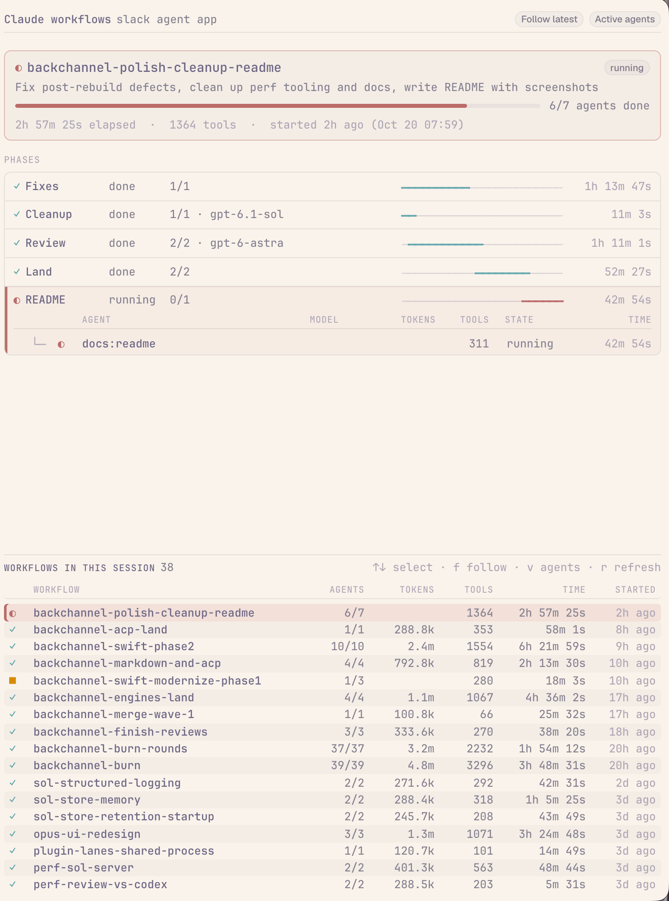

# Claude Workflows for Tern

A [Tern](https://stencil.so/tern) plugin that shows the [Claude Code](https://claude.com/claude-code) workflows of the
session running in the current tab. It works for Claude Code's own terminal interface and for Tern's ACP chats, which
do not show workflow progress yet.



- **Finds the session by itself.** Open it from the palette (⌘K → *View Claude workflows*, or `ctrl+alt+w`) in a tab
  where Claude Code runs. It reads the session that runs in the focused pane, else in another pane of the tab.
- **Follows the newest workflow.** When a new workflow starts in that session, the block switches to it.
- **A summary card** for the selected workflow: status, description, agents done, elapsed time, tokens, tool calls
  and start time.
- **Phases with timelines.** Each phase is one line with its status, `done/total`, model, failures and a timeline bar
  that shows when it ran inside the workflow. Phases can run at the same time, and the bars make that visible.
- **Agents the way Claude Code draws them.** The running or failed phase opens to a table of agents as a tree, with
  columns for model, context tokens, tool calls, state and run time, and `idle` time when a running agent has not written for 30 seconds or more.
  The last tool call of a running agent shows under it. Done agents fold into one line; click a phase or press `v`
  to see them all.
- **Shows past workflows.** Every workflow of the session is listed in a table in its own scroll area at the bottom,
  with its status, agents done, total tokens, tool calls, run time and start. Click one to see it.
- **Opens transcripts.** Click an agent to open its transcript.

## Install

```sh
tern plugin install github.com/cgasgarth/tern-claude-workflows
```

Requires Tern with plugin support, Claude Code with workflows, and a POSIX shell (`sh`, `ps`, `stat`, `grep`). It
runs on macOS and Linux.

## Open it beside a pane from a script or an agent

The palette command acts on the focused pane. A script or an agent can name the pane instead. The block opens
beside that pane, in its tab and session, without moving focus or changing what the window shows:

```sh
tern open --split right "claude-workflows-$TERN_PANE"    # beside the pane this runs in
tern open --split right "claude-workflows-<pane id>"     # beside another pane, for the session in its tab
```

The plugin claims that path, opens the block and moves it beside the named pane. A tab gets at most one block:
when it has one, nothing changes. The command exits 0 when the plugin handled it.

## Keys

| Key | Action |
| --- | --- |
| `↑` `↓` / `j` `k` | Select another workflow (stops following) |
| `f` | Follow the latest workflow on or off |
| `v` | Show all agents, or only active and failed ones |
| `r` | Read every workflow again |

## How it works

Claude Code keeps no API for workflow progress outside its own interface, so the plugin reads the files Claude Code
writes:

- `~/.claude/sessions/<pid>.json` maps each live Claude Code process to its session id. Processes started in a Tern
  pane inherit `TERN_PANE`, which connects a pane to its session. Nested Claude processes inside a session are
  skipped, so the outermost one wins.
- `~/.claude/projects/*/<session>/workflows/<run>.json` is the final state of a finished workflow.
- `~/.claude/projects/*/<session>/subagents/workflows/<run>/` holds a running workflow: `journal.jsonl` (agents
  started, finished, failed), one `agent-<id>.meta.json` and transcript per agent. Context tokens and the last tool
  call come from the end of each transcript.

`scripts/scan.sh` does the file system work every two seconds; `host.luau` builds the view. These files are Claude
Code internals without a documented format, so a Claude Code update can change them.

A running workflow with no writes for 30 minutes and no final state file is shown as stopped.

## Development

```sh
tern plugin link .          # use this checkout; reloads on save
tern plugin reload
tern plugin types /tmp/tern # writes tern.d.luau for luau-lsp
luau-lsp analyze --platform=standard --definitions=@tern=/tmp/tern/tern.d.luau host.luau window.luau
```

## License

MIT
